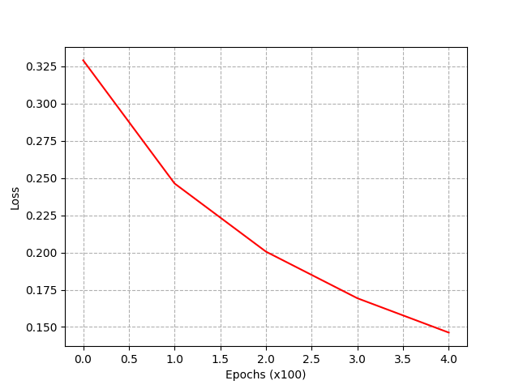

# Handwritten Digit Classifier with a Neural Network

A two-layer neural network implemented from scratch in NumPy and trained with gradient descent to classify MNIST digits. A web interface lets you train the network and draw digits for it to classify.

📄 **Full report (in Portuguese):** [report.pdf](report.pdf)

## Model

- **Data:** MNIST (70,000 28×28 images). Pixels are normalized to [0, 1] and split 80/20 into 56,000 training and 14,000 test examples.
- **Architecture:** 784 inputs → hidden layer with *h* neurons (ReLU) → 10 outputs (softmax).
- **Training:** cross-entropy loss and full-batch gradient descent. Weights are initialized from N(0, 1)·0.01 and biases from zero.

## Results

Best configuration: **α = 0.5, 500 epochs, 256 neurons → 95.44% test accuracy**. Test accuracy goes above 90% at epoch 84.

| Varied hyperparameter | Values | Test accuracy |
|---|---|---|
| Learning rate (h = 64, 500 epochs) | 0.001 / 0.01 / 0.1 / 0.5 | 14.91% / 45.19% / 90.21% / 94.96% |
| Epochs (α = 0.5, h = 64) | 50 / 100 / 200 / 500 | 78.84% / 90.24% / 92.43% / 94.96% |
| Hidden neurons (α = 0.5, 500 epochs) | 4 / 16 / 64 / 256 | 62.33% / 93.72% / 94.96% / 95.44% |

<p align="center">
  
  
</p>
<p align="center"><em>Training loss and test accuracy of the best configuration (x-axis in hundreds of epochs).</em></p>

## Running

From the repository root:

```bash
python -m venv .venv
source .venv/bin/activate   # Windows: .venv\Scripts\activate
pip install -r src/requirements.txt
```

Start the interface and open <http://localhost:5001>:

```bash
python src/server.py
```

To plot the curves from `src/model/` (saved to `src/losses.png` and `src/accuracies.png`):

```bash
python src/plot.py
```

`src/model/` already holds the weights of the best configuration. Click **Load Weights** in the interface to draw digits without training first.

## Structure

```
src/
├── learn.py        # network: initialization, ReLU, softmax, forward pass, loss, gradient step, accuracy
├── server.py       # Flask + Socket.IO server
├── plot.py         # loss and accuracy curves
├── model/          # weights (W1, b1, W2, b2) and loss/accuracy history
├── static/         # interface (p5.js)
└── templates/
```
