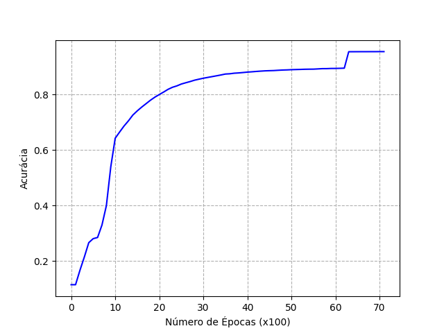

# Classificador de Dígitos Manuscritos com RNA

Rede neural de duas camadas implementada do zero em NumPy e treinada por gradiente descendente para classificar os dígitos do MNIST, com uma interface web para treinar a rede e desenhar dígitos.

📄 **Relatório completo:** [tp2-rna-para-classificacao-de-digitos.pdf](tp2-rna-para-classificacao-de-digitos.pdf)

## Modelo

- **Dados:** MNIST (70.000 imagens 28×28), pixels normalizados para [0, 1], divisão 80/20 (56.000 treino / 14.000 teste).
- **Arquitetura:** 784 entradas → camada escondida com *h* neurônios (ReLU) → 10 saídas (softmax).
- **Treino:** entropia cruzada, gradiente descendente em lote completo; pesos ~ N(0, 1)·0,01 e vieses zerados.

## Resultados

Melhor configuração: **α = 0,5, 500 épocas, 256 neurônios → 95,44% de acurácia de teste** (acima de 90% já na época 84).

| Hiperparâmetro variado | Valores | Acurácia de teste |
|---|---|---|
| Taxa de aprendizado (h = 64, 500 épocas) | 0,001 / 0,01 / 0,1 / 0,5 | 14,91% / 45,19% / 90,21% / 94,96% |
| Épocas (α = 0,5, h = 64) | 50 / 100 / 200 / 500 | 78,84% / 90,24% / 92,43% / 94,96% |
| Neurônios (α = 0,5, 500 épocas) | 4 / 16 / 64 / 256 | 62,33% / 93,72% / 94,96% / 95,44% |

<p align="center">
  
  
</p>
<p align="center"><em>Perda de treino e acurácia de teste da melhor configuração (eixo x em centenas de épocas).</em></p>

## Como executar

Na raiz do repositório:

```bash
python -m venv .venv
source .venv/bin/activate   # Windows: .venv\Scripts\activate
pip install -r src/requirements.txt
```

Inicie a interface e acesse <http://localhost:5001>:

```bash
python src/server.py
```

Para gerar as curvas a partir de `src/model/` (salvas em `src/losses.png` e `src/accuracies.png`):

```bash
python src/plot.py
```

A pasta `src/model/` já contém os pesos da melhor configuração. Basta usar **Carregar Pesos** na interface para desenhar dígitos sem precisar treinar.

## Estrutura

```
src/
├── learn.py        # RNA: inicialização, ReLU, softmax, forward, perda, passo de gradiente, acurácia
├── server.py       # servidor Flask + Socket.IO
├── plot.py         # curvas de perda e acurácia
├── model/          # pesos (W1, b1, W2, b2) e histórico de perda/acurácia
├── static/         # interface (p5.js)
└── templates/
```
